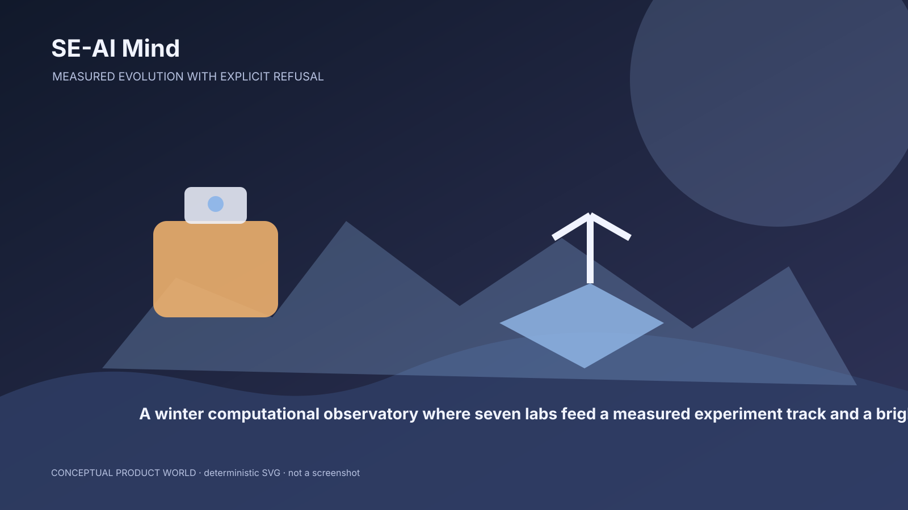
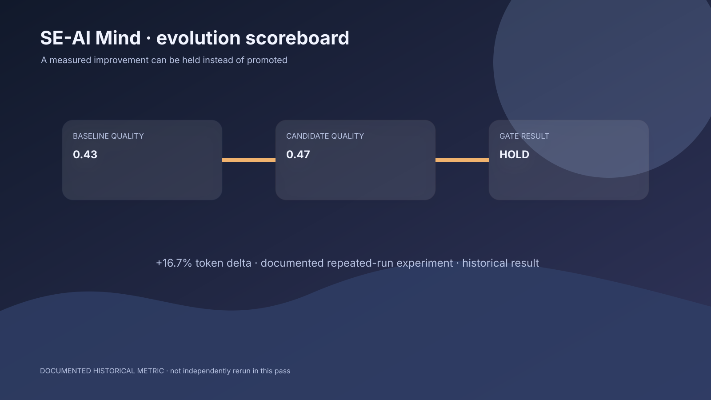
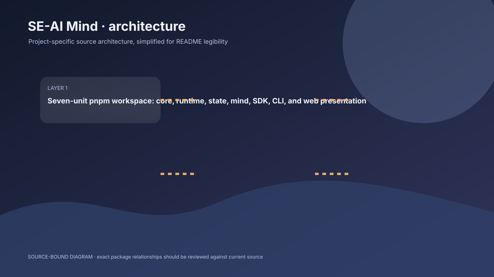

# SE-AI Mind

> A measured AI kernel that can hold a candidate instead of promoting it.

An open-source Darwin 0.1 AI kernel with inspectable schemas, provider-neutral runtimes, mind-scoped memory, skills/tools, genomes, evaluation, and explicit evolution gates.

[Research notes](docs/research) · [NOAERTH](https://www.noaerth.com)



## The computational model

SE-AI Mind is a seven-unit pnpm workspace spanning core schemas and policy, provider-neutral runtime adapters, mind-scoped state, cognition/evolution, SDK, CLI, and web presentation. The cognition path is explicit: `task → memory/skill/tool → runtime → execute → verify → compare → hold/promote/rollback`. Arithmetic uses a parser rather than `eval`, records a deterministic verification result, and does not fabricate a model answer when no healthy runtime is available.



## Run the kernel

```bash
`pnpm install`
`pnpm verify`
`pnpm doctor`
`node packages/cli/dist/cli.js run "What is 2 + 2?"`
`node packages/cli/dist/cli.js evolve verify --mind default`
```

Ollama discovery and generation are real adapter paths; the local adapter is mock behavior. Several CLI groups remain placeholders. The newer measured experiment path is materially implemented, while older generic evolution helpers are less complete.

## Architecture and evidence

Seven-unit pnpm workspace: core, runtime, state, mind, SDK, CLI, and web presentation



| Recorded experiment evidence | Meaning |
|---|---|
| 146 tests documented in changelog (not rerun here) | Source-backed; see `v4/VERIFIED_METRICS.json` for definition and status. |
| 0.43 baseline / 0.47 candidate documented in repeated-run experiment | Source-backed; see `v4/VERIFIED_METRICS.json` for definition and status. |
| +16.7% token delta; gate result HOLD | Source-backed; see `v4/VERIFIED_METRICS.json` for definition and status. |

The documented repeated-run candidate was held because the quality gain was small and token cost increased. That refusal is part of the product's technical story.

## Boundaries

- Local adapter is mock behavior and some CLI groups are placeholders.
- No OS-level sandbox; experiments use storage-backed isolation.
- Small samples and stochasticity limit generalization.

## Source map

- `packages/core/src/schemas.ts`
- `packages/runtime/src/adapters/ollama.ts`
- `packages/state/src/memory.ts`
- `packages/mind/src/cognition.ts`
- `packages/mind/src/experiment.ts`
- `docs/research/TRUSTWORTHY_EVOLUTION_FIRST_EXPERIMENT.md`

## Status

Research-stage open-source kernel / active development. Experiments are small and point-in-time; they are evidence of the evaluation path, not proof of general intelligence or production readiness.
